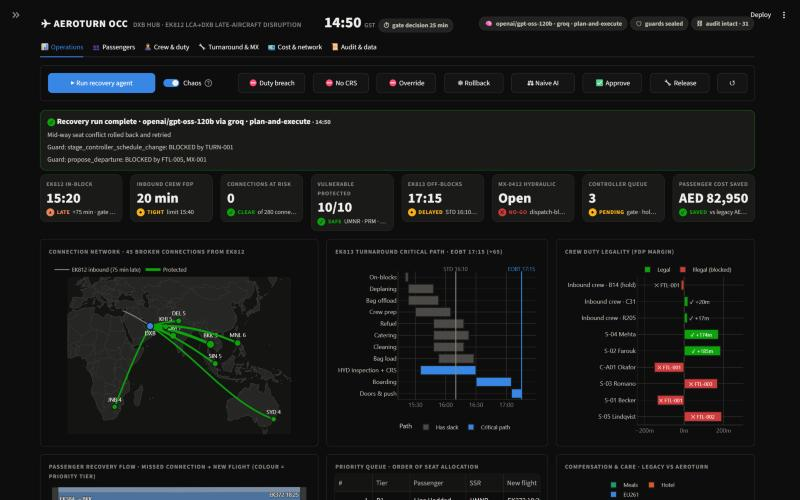
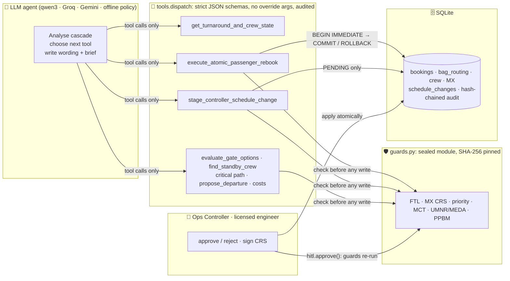
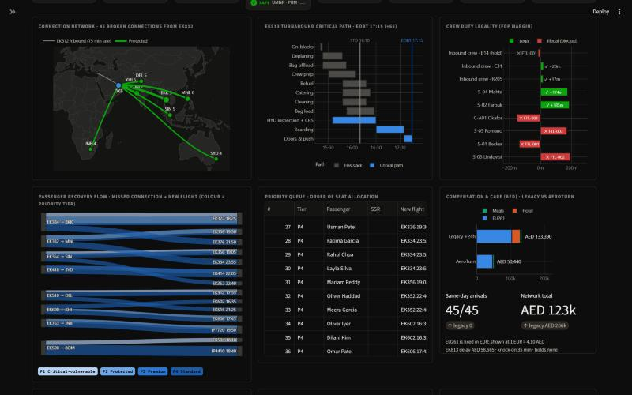

# ✈️ AeroTurn: Autonomous Aircraft Turnaround & Atomic Disruption Recovery Agent

**Domain 4: Aviation & Airport Operations (University Track) · Team EagleX**

[](https://aeroturn-eaglex.streamlit.app)

**Live demo: https://aeroturn-eaglex.streamlit.app**. The 📊 *Operations* dashboard opens first; each scenario is one button in the bar at the top. Every visitor gets
their own copy of the scenario, so click freely and use *↺ Reset scenario* to start over. If the app has been
asleep, the first load takes about a minute.

> A Boeing 777 lands 75 minutes late at Dubai with 280 connecting passengers. The inbound crew is 20 minutes
> from its legal duty limit, a hydraulic defect needs a licensed engineer's sign-off, and the outbound captain
> has just filed a fatigue report. AeroTurn lets an LLM reason about the cascade while plain Python makes the
> unsafe options impossible.



---

## The 30-second version

| | What AeroTurn does |
|---|---|
| 🧠 **LLM agent** | Reads the situation through tools, works out the cascade, decides which recovery action to try next, writes passenger messages and the executive brief. |
| 🔧 **Tools (code)** | Run the three required services: `get_turnaround_and_crew_state()`, `execute_atomic_passenger_rebook()` and `stage_controller_schedule_change()`. Also a standby crew matcher, a turnaround critical path, an EU261 cost model and a priority-protected rebooking planner. |
| 🛡️ **Guards (code)** | `guards.py` is pure Python and **sealed**: assigning to it raises, and its SHA-256 is pinned. It enforces crew FDP, rest, type rating, fatigue, maintenance CRS, vulnerable-passenger priority, passenger-specific MCT and bag-passenger matching. No tool has an `override` parameter. |
| ⚛️ **Atomic state** | Seat and bag rebooking run as **one** `BEGIN IMMEDIATE … COMMIT/ROLLBACK`. A mid-way failure leaves the state hash identical, with 0 double bookings and 0 orphaned bags. |
| 👤 **HITL** | Gate, retime, crew swap and departure release are only **staged**. A named human controller approves them, and the guards **run again** at approval time. The agent has no approval tool. |

**Results on the scenario:**
- 45/45 broken connections recovered: 41 rebooked atomically, and 4 kept on their flight by an 8-minute hold the
  controller approved.
- 10/10 vulnerable passengers protected, and all 45 arrive the same day.
- Passenger compensation and care fall from AED 133,390 (legacy +24h re-protection) to AED 40,200 (−70%);
  AED 50,440 if the controller rejects the hold and all 45 are rebooked.
- Network cost, including the EK813 delay, the knock-on and the hold, falls from AED 206k to AED 121k.
- All money is in UAE dirhams. EU261 amounts are fixed in EUR by law and converted at 1 EUR = 4.10 AED
  (`aeroturn/config.py`).
- 60 automated tests pass.

---

## Quick start

```powershell
pip install -r requirements.txt
streamlit run app.py          # OCC dashboard at http://localhost:8501
python run_demo.py            # the same scenario in the terminal; you approve as the controller
python -m pytest -q           # 60 tests
```

### Choose the brain (optional)

AeroTurn works fully **offline**: a deterministic policy runs the same tool workflow and is clearly labelled as
"no LLM". To use a real LLM, copy `.env.example` to `.env`:

| Provider | Setting | Notes |
|---|---|---|
| **Ollama (local qwen3)** | `ollama pull qwen3:8b`, then `ollama serve` | Auto-detected on `localhost:11434`; uses `/no_think` for speed |
| **Groq** | `GROQ_API_KEY=...` | default `llama-3.3-70b-versatile` (`GROQ_MODEL` to change) |
| **Gemini Flash** | `GEMINI_API_KEY=...` | default `gemini-2.5-flash` (`GEMINI_MODEL` to change) |

`AEROTURN_LLM=auto|ollama|groq|gemini|offline` forces a provider. All three use the OpenAI-compatible
chat-completions API with native tool calling, through a stdlib HTTP client with no SDKs. If the model stalls or
skips a step, a labelled **code autopilot** finishes it, so a live demo never ends half-done.

---

## Architecture



### Four layers of protection against double booking and orphaned bags

1. **Guard pre-validation.** The whole batch is checked in pure Python before `BEGIN`: scope, destination,
   passenger-specific MCT, bag MCT, no downgrade, exit-row eligibility, UMNR/MEDA carrier rules, PNR integrity
   and priority inversion.
2. **Schema constraints during the transaction.** `UNIQUE(flight_id, seat_no)`, `UNIQUE(pax_id, leg_no)`, a
   seat-cabin trigger, and a bag-owner trigger for PPBM.
3. **Invariant scan inside the transaction.** Eight SQL invariants must all be zero before `COMMIT`.
4. **Deferred foreign key at COMMIT.** `bag_routing(pax_id, flight_id) → bookings DEFERRABLE INITIALLY DEFERRED`,
   so a bag can never be committed onto a flight its passenger is not booked on.

Any exception triggers a `ROLLBACK`, and the state fingerprint (SHA-256 over bookings, bag routing and history)
is shown to be identical before and after.

---

## Safety rules → where they are enforced → how they are tested

| Brief requirement | Enforcement | Test |
|---|---|---|
| Atomic state, mid-way rollback | `tools.execute_atomic_passenger_rebook` (4 layers above) | `test_atomic.py` (seat conflict at steps 7 and 30, bag-system fault, deferred FK, replay protection, stale plan) |
| Crew legal duty limits | `guards.check_crew_for_sector`, `check_inbound_crew_on_blocks`: EASA-style FDP table, sector reduction, standby rules per CS FTL.1.225 (airport standby >4h reduces FDP, standby+FDP ≤16h), rest, rating, fatigue, reachability | `test_guards.py`, `test_ops.py::test_standby_matcher…` |
| Mandatory maintenance sign-off | `guards.check_maintenance_release` + `check_crs_signature` (B1 licence, type authorisation, not before the task can finish) | `test_guards.py`, `test_hitl.py::test_full_departure_release_flow` |
| Vulnerable-passenger priority | `guards.pax_tier`, `_priority_inversions`, UMNR/MEDA/PRM rules; planner orders P1 → P4 | `test_priority.py` |
| LLM cannot bypass | Sealed module (`GuardTamperError`), frozen dataclasses, `MappingProxyType`, SHA-256 pin, strict arg schemas, no override params | `test_guards.py::test_guards_cannot_be_mutated`, `test_agent.py` (fake LLM tries override, illegal crew, self-approval, fact-bearing templates) |
| HITL for schedule / gate changes | `stage_controller_schedule_change` → `PENDING`; `hitl.approve()` is not in the tool registry, refuses non-human identities, re-runs the guards and enforces decision deadlines (gate 15:15, holds STD−5) | `test_hitl.py` (incl. hold approve, reject and expiry) |

## Core and stretch goals

- ✅ **Core 1: Late-aircraft recovery path.** Dataset of 342 passengers, 356 bags, 33 crew and 3 MX items;
  45 broken connections, all rebooked with vulnerable passengers first; a full staged recovery plan.
- ✅ **Core 2: Atomic rollback + immutable guards + controller gate.**
- ✅ **Stretch: standby crew pairing matcher.** Picks the nearest *legal* captain. The inbound captain, 0 min
  away, is rejected under FTL-001; the A380-only captain under FTL-003; the 9h-rest captain under FTL-002.
- ✅ **Stretch: below-wing critical-path tracker.** CPM over 11 tasks. The hydraulic inspection is on the
  critical path, giving EOBT 17:15 (+65 min).
- ✅ **Stretch: EU261 / cascade cost calculator.** Whole-journey EU261 because the flight departed Larnaca (EU),
  plus duty of care, the outbound delay and its knock-on to the return sector.
  - **Hold-or-rebook analysis:** for every broken connection, hold cost (aircraft plus passengers on board) is
    compared with rebooking cost.
  - The agent stages the one hold that pays off, EK418 to Sydney (+8 min), and the planner leaves those
    passengers alone until the controller decides.
- ➕ **Extras:**
  - Hash-chained, tamper-evident audit log (with a live tamper test)
  - Prompt-injection passenger remark that goes nowhere
  - Notification templates validated so the LLM can never state a flight, time, seat or gate itself
  - Numeric grounding check on the LLM brief
  - Gate decision deadline with expiry
  - Guard re-validation at approval
  - One-shot chaos injection, never reachable by the LLM

## The scenario (synthetic, reproducible, seed 812)

All times are in GST (Dubai local) on 21 Nov 2026. The scenario clock starts at 14:50.

- **EK812 LCA→DXB**, B777-300ER A6-EQX: STA 14:05, in-block 15:20 (+75 min) after a HYD SYS C caution at Larnaca.
- **Inbound crew:** reported 04:40 for 2 sectors, so the max FDP is 11:00 and the limit is **15:40**. The planned
  stand B14 is blocked until 15:52, and holding for it would breach FDP by 15 min. C31 is legal.
- **MX-0412** (ATA 29, MEL 29-11-01 (M)): inspection plus CRS by a B1 engineer before the next departure.
- **EK813 DXB→CDG**: the rostered captain filed a fatigue report at 14:12.
- **45 broken connections:**
  - 2 unaccompanied minors (to BKK and SIN)
  - a WCHC passenger aged 78
  - a dialysis patient whose MEDIF is home-carrier only
  - a passenger 32 weeks pregnant
  - a blind passenger
  - WCHR and WCHS passengers
  - an 82-year-old travelling with her son
  - a family with a lap infant
  - 5 premium passengers
  - 30 standard passengers, one of whom carries a prompt-injection remark
- Re-accommodation inventory is deliberately scarce (2 to 4 seats on the next flights), so priority decisions
  actually matter.

Files: `data/aircraft_turnaround_disruption.sqlite` (pristine) and `data/scenario_snapshot.json`. Regenerate
them with `python scripts/build_dataset.py`.

## Repository layout

```
app.py                     Streamlit OCC console (guided demo + 9 deep-dive tabs)
run_demo.py                terminal version of the demo (presentation fallback)
aeroturn/
  guards.py                IMMUTABLE safety floors (sealed + SHA-256 pinned in guards.sha256)
  tools.py                 agent tools incl. the 3 required services; strict schemas; dispatcher
  hitl.py                  controller approval / rejection, engineer CRS, sim clock (NOT agent-callable)
  agent.py                 LLM loop + offline policy + completeness check + code autopilot
  llm.py                   Ollama / Groq / Gemini via OpenAI-compatible API (stdlib only)
  recovery.py              connection risk + priority-protected planner (+ unconstrained baseline)
  crew.py                  standby crew pairing matcher
  turnaround.py            critical-path (CPM) tracker
  costs.py                 EU261 / duty-of-care / delay / hold analysis
  narrative.py             executive brief, notification templates, grounding check
  db.py · audit.py         schema, invariants, fingerprint · hash-chained audit
  dataset.py               synthetic scenario generator
  faults.py · lab.py       chaos injection · sandboxed experiments
data/                      pristine SQLite + JSON snapshot
docs/                      DEMO_SCRIPT.md · PITCH.md · ARCHITECTURE.md
tests/                     60 pytest tests
```

## Deploying the live demo (Streamlit Community Cloud, free)

1. Sign in at [share.streamlit.io](https://share.streamlit.io) with the GitHub account that owns this repo.
2. Click **Create app** and choose **Yup, I have an app**.
3. Enter repository `RithikhC/EagleX`, branch `main`, main file `app.py`. Under **App URL**, enter
   `aeroturn-eaglex`.
4. Optional: open **Advanced settings**, pick Python 3.12, and under **Secrets** add an LLM key so the hosted
   agent uses a real model instead of the offline policy:
   ```toml
   GROQ_API_KEY = "gsk_..."
   ```
5. Click **Deploy**. Pushing to `main` redeploys automatically.

## Data and sources

Every dataset, public source (EASA flight-time rules, Part-66, ICAO Annex 17, EU261 and its case law including *Gahan v Emirates*), and every modelling assumption is listed in **[docs/DATA_SOURCES.md](docs/DATA_SOURCES.md)**.

## Honest limitations

- The flight time limitations are a simplified, EASA-style model (ORO.FTL.205 table, standby and rest rules),
  not a certified UAE GCAA CAR-OPS implementation.
- EU261 treatment and cost rates are illustrative assumptions (`aeroturn/config.py`), not legal advice.
- All flights, people and numbers are synthetic. The flight number EK-812 comes from the problem statement.
  Partner carrier "IP" is fictional.
- Single-node SQLite. In production, the same pattern maps to `SERIALIZABLE` transactions in a reservation
  system, plus an outbox for BHS/DCS messages.

## The dashboard

One screen, with a scenario bar across the top. Each button runs one judged scenario against the live state,
and the panels update in place.

| Button | Scenario | What the dashboard shows |
|---|---|---|
| ▶ Run recovery agent (+ Chaos) | The LLM agent runs the full recovery; a seat is sold mid-batch | Incident banner, event feed (LLM ↔ tools ↔ guards), KPIs go 45 → 0 at risk, 0/10 → 10/10 vulnerable safe, map arcs turn green |
| ⛔ Duty breach | Rogue LLM dispatches EK813 with the inbound crew | Banner: BLOCKED, FTL-001 for every crew member + TURN-001 + MX-001 |
| ⛔ No CRS | Legal crew, but the hydraulic CRS is unsigned | Banner: BLOCKED, MX-001 |
| ⛔ Override | Tool call with `override=True` | Banner: REJECTED, no override exists |
| ⚛ Rollback | Seat conflict at step 7 on a sandbox copy | Banner: rolled back, 0 double bookings, 0 orphaned bags, state identical, retry committed |
| ⚖ Naive AI | Revenue-first optimiser vs the same guards | Banner: 15 violations (PAX-001/002/003/004/006), AeroTurn plan committed |
| ✅ Approve | The human controller approves the queue | Gate moves to C31, crew swap and retime applied |
| 🔧 Release | Clock to inspection end; B2 then B1 engineer sign; departure release | MX-002 refusal, CRS signed, EK813 released |
| ↺ | Reset | Back to 14:50 |

Panels:
- Connection network map (status per destination)
- EK813 critical-path timeline (now / STD / EOBT)
- Crew FDP legality: inbound crew per stand, standby captains
- Recovery flow, from missed connection to new flight, coloured by priority tier
- Priority queue in seat-allocation order
- Compensation & care, legacy vs AeroTurn
- Live event feed, rebuilt from the audit log after a reload
- Controller queue with Approve / Reject
- Guard interventions

Detail tabs cover passengers, crew & duty, turnaround & MX, cost & network, and the audit log with the data sources.



See [docs/DEMO_SCRIPT.md](docs/DEMO_SCRIPT.md) for the presentation run-sheet and [docs/PITCH.md](docs/PITCH.md)
for the pitch and judge Q&A.
